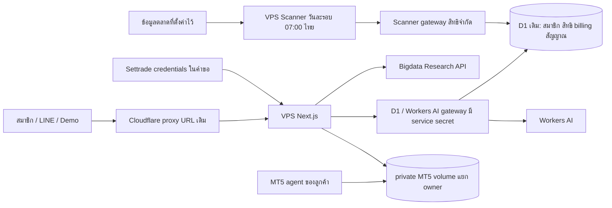
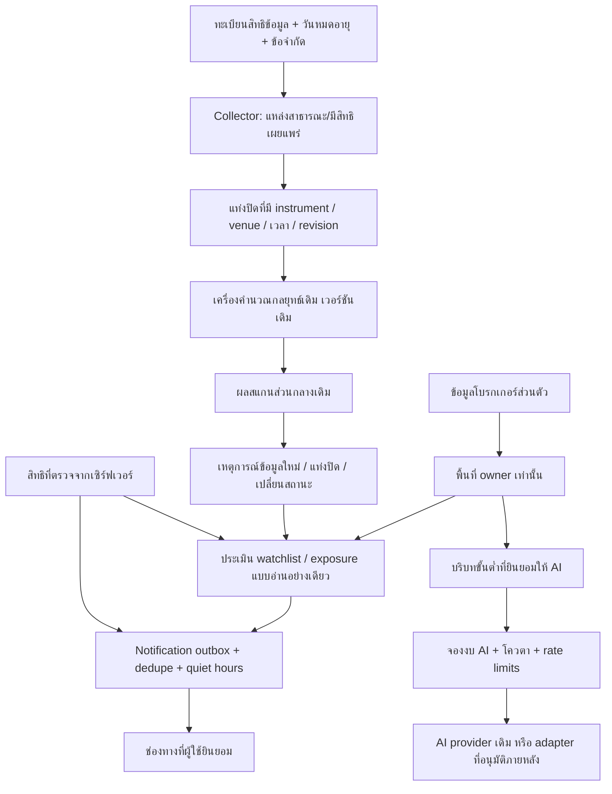

# สถาปัตยกรรมและขอบเขตการเปลี่ยนแปลง — ข้อเสนอเพื่อทบทวน

วันที่ 25 ตุลาคม 2026 · baseline `b2f8cb233f397cf1c0452982d9a0e2d87a15f8d7`

เอกสารนี้ไม่ได้เปลี่ยนการตั้งค่า production ราคา โควตา ฐานข้อมูล หรือสูตรกลยุทธ์
โหมดส่วนกลางวันละครั้งที่เลือกไว้เดิมยังเป็นค่าฐาน ทุกคำว่า “เพิ่ม” ด้านล่างเป็นงานเสนอ
ยกเว้นส่วนที่ระบุว่าติดตั้งและทดสอบก่อนเริ่ม audit แล้ว

## 1. สิ่งที่ใช้งานอยู่

เว็บและ Scanner ย้ายได้ด้วย Docker; D1 ยังเป็นฐานข้อมูลหลัก ไม่ได้ย้ายสมาชิกไป SQLite
ค่าระบบอยู่ไฟล์ root 0600 บน VPS; private MT5 อยู่ volume แยก บัญชีส่วนตัวไม่ใช่แคชส่วนกลาง
`web-data` เป็น backend principal ที่สิทธิกว้างกว่า scanner credential ต้องแยกคีย์และห้ามส่งให้ browser
เลขบัญชีและข้อมูลพอร์ตไม่ควรอยู่ใน telemetry/cache สาธารณะ แม้ทุกคำขอจะใช้ HTTPS แล้ว

## 2. โครงสร้างที่เสนอเพิ่ม

หลักการคือเก็บข้อมูลครั้งเดียวต่อ instrument/venue/ช่วงแท่ง/สิทธิแหล่งข้อมูล แล้วเรียก
กลยุทธ์เดิมกับข้อมูลเดิมแบบ incremental เฉพาะเมื่อเกิดข้อมูลใหม่ งานรายสมาชิกประเมินเฉพาะ
watchlist/พอร์ตของเจ้าของ ไม่เปิด full-market scan ต่อ subscriber

ข้อมูล broker ของสมาชิก A ห้ามใช้เติม shared cache หรือให้สมาชิก B แม้ symbol เหมือนกัน
การ dedupe ข้ามสมาชิกทำได้เฉพาะชุดข้อมูลส่วนกลางที่มีสิทธิใช้ร่วมกันชัดเจน

## 3. ความถี่: สี่ชั้นที่ต้องแยก

| ชั้น | ปัจจุบัน | ข้อเสนอที่ยังไม่เปิด |
|---|---|---|
| เก็บ raw market data | รอบส่วนกลางรายวัน | ไทย/DR ทุก 5 นาที; Forex 1–5 นาทีเฉพาะแหล่งที่อนุญาต |
| คำนวณกลยุทธ์ | กฎและข้อมูลแท่งปิดเดิม | เรียกเมื่อข้อมูลเข้าเงื่อนไขเดิม ไม่ใช้แท่งไม่ปิดแทน |
| ประเมินส่วนบุคคล | ยังไม่มี personal alert scheduler ครบวงจร | Starter 30 นาที, Pro 5–15, Elite 1–5 เฉพาะมีข้อมูลใหม่/สิทธิรองรับ |
| หน้าเว็บ refresh | หลายหน้าดึง JSON ประมาณนาทีละครั้ง | ปรับเพื่อ UX ได้ แต่ต้องไม่เรียกว่า raw feed สดขึ้น |

Free อัปเดตผลรายชั่วโมงเป็นได้เพียงความถี่เผยแพร่ หาก underlying มีข้อมูลใหม่จริง
ในโหมดรายวันทุกระดับต้องเห็นเวลาต้นทางเดิม ไม่สร้างความแตกต่างปลอมด้วยตัวจับเวลา
การเพิ่มรอบไม่เปลี่ยนเงื่อนไข Entry/TP/SL, tick rounding, closed-bar eligibility,
cost profile, signal ID, lifecycle หรือประวัติของเวอร์ชันเดิม

รอบรายวันปัจจุบันรวม 926 instruments ไม่ใช่ API request เดียว สมมติข้อมูลไทย/DR/US
ต้องสอง timeframes และ Forex/TFEX หนึ่งชุด จะประมาณ 1,817 upstream calls/รอบก่อน cache/retry
นี่เป็นสมมติฐาน จำนวน HTTP จริงยังไม่ได้ instrument ครบ การเปลี่ยนไทย/DR เป็น 5 นาที
ที่สมมติ 54 รอบ/วันและ Forex ทุก 5 นาที อาจเพิ่มเป็นราว 38,116 calls/วัน;
Forex ทุกนาทีอาจเพิ่มเป็นราว 60,004 calls/วัน จึงห้ามใช้ราคา VPS อย่างเดียวตัดสินต้นทุน
DR ต้องใช้ปฏิทินแต่ละ session/ตลาดอ้างอิงจริง ไม่ยึด 54 รอบเป็นกฎ production

## 4. Entitlement engine แบบต่อเพิ่ม

ปัจจุบัน `src/billing/plans.mjs` และ `src/membership/rights.mjs` เป็นแหล่งสิทธิบนเซิร์ฟเวอร์
มีข้อมูล subscription และ daily usage ใน D1 อยู่แล้ว ไม่ควรแทนที่ทั้งหมด
เสนอเพิ่มตาราง versioned catalog และ usage ledger ใน migration แบบ additive:

| ตารางใหม่ (เสนอ) | หน้าที่ |
|---|---|
| `plan_versions` | plan key, version, interval, effective date, cohort, status |
| `plan_features` | feature key, boolean/numeric limit, quota period, rate cap |
| `member_plan_assignments` | member, policy version, starts/ends, legacy fallback |
| `usage_periods` | member + feature + period, limit snapshot, used, reserved |
| `usage_reservations` | owner, idempotency key, payload hash, units, lease, outcome |
| `provider_cost_ledger` | provider/model/usage/cost/currency/receipt reference |
| `notification_rules` / `notification_outbox` | owner-only rule + delivery dedupe |
| `data_source_rights` | contract reference, redistribution/non-display scopes, expiry |
| `feature_flags` | flags, default false, rollout allowlist, audit actor |

ยังไม่สร้างหรือแก้ตารางเหล่านี้ และไม่แปลงสมาชิกเดิมในรอบ audit
ใช้ `legacy_v1` เป็น fallback ที่คืนสิทธิเดิมทุกกรณี ไม่มี catalog v2 ต้องไม่ทำให้ลูกค้าเดิมเสียสิทธิ
ชื่อ Ultimate ใน Stripe/DB ต้องคง key เดิมไว้; “Elite” เป็นชื่อเสนอสำหรับหน้าขายเท่านั้น
ห้าม rename IDs, remap paid subscriptions หรือเปลี่ยนราคาใน Stripe โดยอัตโนมัติ

### จุดบังคับใช้

ฟังก์ชันกลาง `resolveEntitlements(member, now)` อ่านสถานะที่ยืนยันจาก billing + policy version
ก่อน `authorize(member, feature, resourceOwner)` และ atomic `reserveUsage(...)` สำหรับงานมีต้นทุน
ตรวจซ้ำตอน worker เริ่มทำงาน ตอนส่งแจ้งเตือน และตอนต่อ WebSocket/export เมื่อมีฟีเจอร์เหล่านั้น
UI อ่าน decision object เดียวกันเพื่อแสดงเหตุผล ไม่ใช้การซ่อนปุ่มเป็น access control
cache ส่วนตัวต้องรวม member ID, entitlement revision, plan version และวันสิ้นสุดสิทธิ
แคชราคา shared ต้องไม่รวม private portfolios หรือคำตอบ AI ที่มีบริบทบัญชี

`used + reserved + requested <= limit` ต้องอัปเดตแบบ atomic และคืน idempotent result
หาก provider อาจคิดเงินแล้วแต่ผลลัพธ์ไม่แน่ชัด ให้ reconcile ก่อนคืน reservation/ทำซ้ำ
กรณี Demo ยังต้องใช้ AI จริงตามการอนุญาตเดิม; budget cap ใหม่ต้องเสนอขอบเขตและอนุมัติก่อนใช้

### Billing lifecycle ที่ต้องต่อและทดสอบ

- Checkout → verified signed webhook → server subscription state → entitlement; redirect สำเร็จอย่างเดียวไม่ให้สิทธิ
- งาน reconciliation อ่านสถานะล่าสุดจาก Stripe สำหรับ webhook ที่ตกหล่น และรับ duplicate/out-of-order อย่าง idempotent
- ต่ออายุเมื่อ invoice จ่ายจริง; payment failed เก็บ paid-through เดิม; grace ใหม่เสนอเฉพาะอ่านข้อมูล 3 วันโดยไม่แจก AI เพิ่ม
- ยกเลิกปลายรอบต้องรักษาสิทธิถึง paid-through; downgrade ปลายรอบ ไม่ลบ watchlist หรือประวัติที่เกิน limit ใหม่
- Upgrade ต้องแสดง prorated charge และให้ลูกค้ายืนยันใน flow ชำระเงิน; ห้ามเรียกเก็บเพิ่มจาก audit นี้
- Annual discount 15% เป็นสมมติฐานเท่านั้น ปัจจุบัน validator รองรับ monthly จึงต้องเพิ่มเส้นทางแบบ versioned และทดสอบแยก
- ช่วง quota รายเดือนต้องอิง billing period จริง ไม่ถือว่าเดือนทุกเดือนมี 30 วัน; 30 วันใช้เฉพาะแบบจำลองต้นทุน

## 5. Worker และ observability

คง lease/fencing เดิม จองงานตาม `(dataset, instrument, timeframe, closedAt, ruleVersion)`
แยก collector concurrency, strategy concurrency, personal evaluations และ AI ไม่ให้ provider ช้ากิน worker ทั้งหมด
ใช้ bounded queue + token bucket ต่อ provider, Retry-After, jittered retry เฉพาะอ่านแบบ idempotent,
circuit breaker และ dead-letter ที่มีเหตุผล ห้าม retry งานคิดเงิน/เขียนข้อมูลโดยไม่ใช้ idempotency
การทำ market-calendar aware ในอนาคตต้องไม่แก้กฎ signal หรือรีเซ็ต checkpoint รายวันย้อนหลัง

เก็บ metric: provider HTTP counts/status/429, scan delayและmissing symbols, queue age,
lease conflicts, D1 rows read/written, bridge calls/API, RSS/CPU/event-loop lag,
API p50/p95/p99, stale-cache ratio, delivery dedupe, AI input/output/tool units และ actual baht
ห้ามบันทึกคีย์ เลขบัญชีเต็ม session cookie หรือ prompt ที่มีข้อมูลพอร์ตลง public log
threshold แจ้งเตือนงบรายวัน/เดือนต้องมี project owner ยืนยัน ไม่ถือว่างบหมดแล้วรับรองว่าผู้ให้บริการหยุดคิดเงินเอง

## 6. งานเสนอ: เดิม → เปลี่ยน → คงเดิม → compatibility → อนุมัติ → regression/rollback

| ID / Phase | พฤติกรรมเดิมและสิ่งที่จะเพิ่ม | สิ่งที่คงไว้ | Compatibility / approval | Verification และ rollback |
|---|---|---|---|---|
| A0 / 0 | เก็บ baseline + inventory + ตัวเลขจำลอง | source/DB/settings ทุกตัว | อ่านอย่างเดียว; ทำแล้วในเอกสารนี้ | SHA-256 565 files, commit, test logs; ไม่มี production migration |
| T1 / 0 | Live portfolio enrichment ให้ Stage/FAIR คงที่ → เสนอแสดง unassessed พร้อมหลักฐานที่ใช้ | broker balances/holdings, signal engine, Entry/TP/SL และ records | เป็นการเปลี่ยน output ที่ผู้ใช้เห็น ต้องอนุมัติ patch เฉพาะจุดก่อน | real-adapter fixture ไม่เกิด Stage/FAIR เมื่อข้อมูลไม่พอ; legacy signal parity; คืน route revision เดิมได้ |
| B1 / 0 | Checkout เปิดได้ แต่ entitlement delivery ยังไม่ผ่านจริง → ต่อ Test webhook + reconcile | ราคา mode Test/member IDs/session | configuration test; ห้ามเปิด Live จนเจ้าของอนุมัติ | invoice paid/failed, duplicate, out-of-order, cancel/refund, outage/retry; revoke staging endpoint เมื่อจบ |
| R1 / 0 | rights flags มีแล้วแต่ยังไม่เห็นสัญญา → เก็บทะเบียนสิทธิและต้นทุน | adapters และ source timestamps | ยังไม่เปิดรอบใหม่หรือประกาศ rights จาก flag | เอกสาร scope/expiry; ปิดเฉพาะ flag ใหม่ ไม่ drop cache/history |
| U1 / 1 | nav/overview กระจายหลายตลาด → เพิ่ม Thailand-first overview หลัง flag `THAILAND_OVERVIEW_V2` default false | URL เดิมทุกหน้า, US, account/auth, charts/rules | เพิ่ม route ได้; การซ่อน/ย้าย default navigation ต้อง review ก่อน rollout | desktop/mobile, keyboard, deep linksทุกตลาด, Demo/LINE session, no calculation diff; ปิด flag |
| C1 / 1 | capability บอก manual scan ได้แต่ daily mode ตอบ 409 → เสนอ copy อธิบายข้อมูลรายวันตรงกับ API | manual scan policy/server rights/strategy | UI disclosure ไม่เพิ่ม/ลดสิทธิ | ข้อความ snapshot/source age + current-role snapshots; revert component |
| E1 / 3 | server hardcoded plan map → เพิ่ม catalog v2 แบบ shadow/read-only | legacy v1 ทุกฟีเจอร์และ 500 favorites เดิม | migrations additive; default fallback; การย้ายคน/เปลี่ยนโควตาต้องอนุมัติ | compare all six Demo + guest/legacy/paid states, quota races, worker/API parity; ปิด `ENTITLEMENTS_V2` ก่อน rollback; ไม่ลบ ledger |
| Q1 / 3 | daily question limits แต่ไม่มี global spend budget → เพิ่ม cost ledger + reserve budgets หลัง flag | AI provider/คำตอบจริง Demo/โควตาเดิมจนอนุมัติ | ขอบเขตงบอาจจำกัดการใช้งาน ต้องยืนยัน cap ก่อน enforce | concurrent reservations, provider timeout, retries, receipts, owner isolation; ปิด enforcement flagแต่คง ledger |
| S1 / 2 | daily collector เดิม → เพิ่ม instrumented queue/cache/calendar adapters แบบ shadow | daily schedule, lease, formulas/rule versions/history | default off; ห้ามเพิ่มรอบ live feed โดยไม่อนุมัติสิทธิและค่าใช้จ่าย | captured-bar replay parity, no duplicate jobs, crash/resume, holiday/DST, 429/backpressure; ปิด `INTRADAY_DATA_V2` |
| P1 / 4 | พอร์ตหลายหน้าและ demo → เพิ่ม read-only normalized view พร้อม data status | existing broker endpoints/IDs/keys/legacy MT5 project | routeใหม่/flag; ไม่ย้าย volume หรือบังคับเปลี่ยน account | two-owner isolation, revoke, missingFX, stale positions, reconnect; ปิด `PORTFOLIO_OVERVIEW_V2` |
| N1 / 4 | manual Telegram/notification inbox → เพิ่ม owner-only outbox และ alert rules | existing manual integrations, scanner rules | notification opt-in; ไม่ส่งจริงใน audit; new quotaต้องapprove | signal+bar+rule dedupe, expired plan recheck, quiet hours, retry exactly-once effect; stop new dispatcher |
| W1 / 4 | ยังไม่มี weekly review service → เพิ่มบทสรุปจากเหตุการณ์ที่มีหลักฐาน | existing histories/private portfolio consent | draftก่อน opt-in delivery; ไม่ส่งข้อความแทนผู้ใช้ | one-owner scope, snapshot dates, no invented P/L, duplicate week; ปิด scheduled flag |
| L1 / 5 | ไม่มี load certification → benchmark staging 100/500/1000/5000 | production feed/quota/DB/customer records | ห้าม stress production ใช้ฐาน staging + synthetic dataติดป้าย | ramp/soak/scanner overlap, p95<1.5s,p99<3s,error<1%, no leaks; ผลจริงจึงตัดสินเครื่อง |

ทุก threshold ใน L1 เป็น acceptance target ที่เสนอ ไม่ใช่ผลทดสอบที่ผ่านแล้ว
ไม่ drop ตารางเก่าหรือแก้ historical signals เพื่อทำให้คะแนนใหม่ดูดี หากพบ defect ในสูตรจริง
ต้องเก็บตัวอย่าง reproducer, เปรียบเทียบก่อน/หลัง, ขออนุมัติผลกระทบ และออก strategy version ใหม่
เมื่อจำเป็น ไม่เขียนทับประวัติรุ่นเดิม

## 7. Dependencies และลำดับทำจริง

T1 + B1 + LINE human acceptance + R1 → readiness review → U1/C1 แบบ flag →
E1/Q1 shadow → S1 หลังได้แหล่งข้อมูล/สิทธิ/งบ → P1/N1 → W1 → L1/limited beta
งาน E1/S1 ไม่ควรถูกเร่งเพียงเพื่อเพิ่มจำนวนแพ็กเกจ หาก live billing และความถูกต้องของพอร์ตยังไม่ผ่าน

ค่า estimate engineering (สมมติทีมเล็ก ไม่ใช่สัญญากำหนดส่ง): T1 1–2 วัน,
B1 2–4 วันหลังมี config, U1/C1 2–4 วัน, E1/Q1 5–10 วัน,
S1 5–10 วันหลังได้สัญญาข้อมูล, P1/N1 5–10 วัน, W1 2–4 วัน, L1 2–5 วัน
ระยะรอผู้ให้บริการ/การอนุมัติไม่รวม estimate นี้

## 8. หลักฐานอ้างอิง

- [Existing source at baseline](https://github.com/nuibhr/market-signal-workspace/tree/b2f8cb233f397cf1c0452982d9a0e2d87a15f8d7)
- [D1 pricing และขีดจำกัด](https://developers.cloudflare.com/d1/platform/pricing/)
- [Workers pricing](https://developers.cloudflare.com/workers/platform/pricing/)
- [SET: internal use กับ redistribution ต่างเงื่อนไขกัน](https://www.set.or.th/app/online-data/market-data?lang=en)
- [MetaTrader investor password เป็น read-only](https://www.metatrader5.com/en/mobile-trading/iphone/help/settings_accounts/account_passwords)
